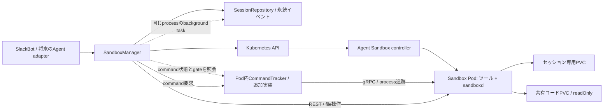
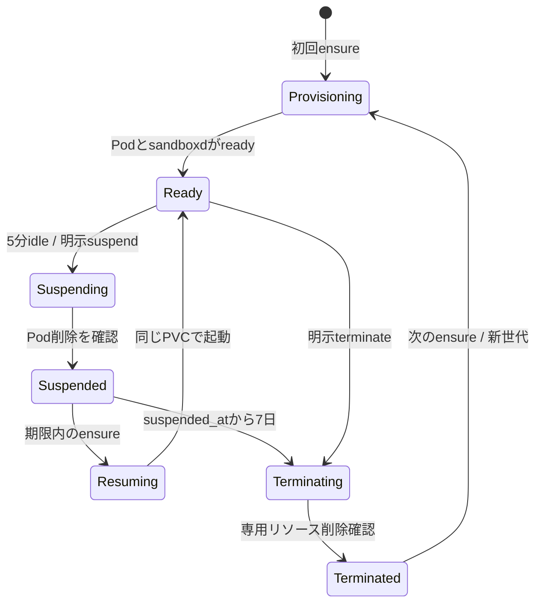

# GKE Agent Sandbox + sandboxd Pythonライブラリ仕様案

SlackBotからClaude Agent SDKを利用する際に、会話セッションごとの作業環境をGKE上で管理するためのPythonライブラリを設計する。Sandboxの作成・再接続・サスペンド・終了と、sandboxd経由のコマンド実行・ファイル操作を提供する。

**Python packageの主要機能を実装し、専用GKE上でsession manager、sandboxd command / file経路、suspend / resume、tracker復旧、300秒idleによる自動suspend、10秒・60秒保持期限後の削除・新世代作成・通知を検証済み。** 全16シナリオの受け入れが完了したという意味ではなく、7日間の実時間待ちはしていない。環境・実施範囲・制限は[session managerのGKE検証記録](docs/validation/session-manager-gke.md)を参照。設定描画とGKE上のasync lifecycle例は[async利用例](docs/async-usage.md)を参照。公式資料・ソース確認日: 2026-10-10。

`gke-session-sandbox`は`protobuf>=6.31.1,<7`に対応し、`google-cloud-aiplatform`などprotobuf 7を許さない依存との同居を可能にする。sandboxd protocolの生成コードもprotobuf 6対応版を同梱する。実際のsolver確認で`google-cloud-aiplatform 2.4.0`と同じ環境に解決できることを確認した。

## 1. 提案の要点と前提

| 項目 | 初期仕様案 |
| --- | --- |
| ライブラリ名 | 配布名 `gke-session-sandbox`、import名 `gke_session_sandbox`（仮称） |
| API | Python 3.11以上、async APIを基本とする |
| セッション | 呼び出し元が渡す安定した`SessionKey`につき、使用可能なSandboxは最大1つ |
| テンプレート | Git管理するYAML + 型付きパラメータの挿入。コンテナimageを指定可能 |
| 作成方法 | 初期版はcore `Sandbox`を直接作成。WarmPool / Claimは後続拡張 |
| 実行環境 | Python・Git等のツールとsandboxdを同一コンテナに配置 |
| アイドル | 実行中commandが0件、かつ最後のcommand終了から5分経過したらサスペンド |
| サスペンド | Podを終了して専用PVCを保持。再開時にPodを作り直す |
| 保持期限 | サスペンド完了から7日後にSandboxと専用ワークスペースを削除 |
| 再利用 | 期限内は同じ作業ファイルで再開。期限後は新しい世代を作成 |
| 消失通知 | 永続イベントとして保持し、呼び出し元が次の会話コンテキストへ反映 |
| 共有コード | 既存PVCを読み取り専用マウント。Sandbox終了時にも削除しない |
| ネットワーク | GKEのFQDNNetworkPolicyと通常のNetworkPolicyを併用 |
| 自動管理 | API process内のbackground taskが60秒ごとにcommand状態を確認し、Kubernetes APIで停止 |
| 作成時パラメータ | 追加envをruntime containerへ挿入。ユーザメールアドレス等を渡せる |
| Kubernetesメタデータ | session ID、実行数、最後の終了時刻、0件確認時刻等をannotationsへ記録 |

元の依頼の「ワークスペース用VPC」は、ライフサイクル連動という文脈から**PVC（PersistentVolumeClaim）を意図したものと仮定**する。VPCを意図している場合は別要件となる。初期版では既存GKEクラスタのVPCを使い、セッションごとのVPC作成・削除は扱わない。

「ReadMany」はKubernetesの正式なaccess modeではないため、共有コードは`ReadOnlyMany`（ROM）、書き込みも必要な共有ストレージは`ReadWriteMany`（RWX）と区別する。初期版はROM、またはRWXのPVCを`readOnly: true`で使う。[GKEのボリュームとaccess mode](https://docs.cloud.google.com/kubernetes-engine/docs/concepts/persistent-volumes?hl=en)

「バイパスする」は**Sandbox Routerを通さずsandboxdへ直接接続する**意味と解釈する。gVisorやネットワーク制御を迂回する仕様ではない。

## 2. 公式機能との分担

Agent SandboxはPodと永続ボリュームを管理するKubernetes controller。GKE Sandbox / gVisorはコンテナの隔離機構であり、役割が異なる。GKE上の実行PodにはgVisorを利用する。[GKE Agent Sandboxガイド](https://docs.cloud.google.com/kubernetes-engine/docs/how-to/agent-sandbox)

**GKE上でAgent Sandboxのv1beta1 APIを使うことを前提**とする（依頼の「v1bata」はv1beta1として扱う）。GKEクラスタ自体のバージョンやcontrollerのリリース番号とは区別する。調査時に取得できたcontroller **v1.0.6**の定義を参照し、core APIは`agents.x-k8s.io/v1beta1`で、`spec.operatingMode: Running | Suspended`、`spec.service`、`spec.volumeClaimTemplates`、`spec.shutdownTime`、`spec.shutdownPolicy`を持つ。旧版の`replicas: 0/1`をこの仕様に混在させない。[v1.0.6 Sandbox API定義](https://github.com/kubernetes-sigs/agent-sandbox/blob/v1.0.6/api/v1beta1/sandbox_types.go)

| 既存機能を利用する部分 | このライブラリで追加する部分 |
| --- | --- |
| Sandbox controllerによるPod / Service / PVC作成 | セッションからSandboxへの安定した対応付け |
| operatingModeによる停止・再開 | 5分アイドル判定、処理中の保護、7日保持 |
| shutdownTimeによる絶対時刻の期限処理 | 期限の設定・解除と削除後の記録・復旧 |
| sandboxdの実行・ファイルAPI | セッション単位の接続管理、例外・タイムアウトの統一 |
| Kubernetes / GKEのネットワーク制御 | セッション用selector、ポリシーの生成・検証 |
| 公式Python SDKのtransport / runtime機能 | 永続状態、イベント、冪等性、ライフサイクル制御 |

公式Python SDK `k8s-agent-sandbox`をまず再利用する。async / gRPC extrasとsandboxd用接続設定が存在する。ただしcore Sandboxを直接作成した後に既存Sandboxへ接続できるか、切断が削除を伴わないかを最初の検証で確認する。適切な公開APIがない部分はadapter内でKubernetes API、生成gRPC stub、HTTP clientを使用し、SDKのprivate APIには依存しない。[公式Python client](https://agent-sandbox.sigs.k8s.io/docs/python-client/)、[v1.0.6 接続設定](https://github.com/kubernetes-sigs/agent-sandbox/blob/v1.0.6/clients/python/agentic-sandbox-client/k8s_agent_sandbox/models.py)

controller / CRD / SDK / sandboxdのバージョンとコンテナimage digestは、実クラスタで組み合わせを検証してからlockする。`latest`で再現性を担保しない。Pod snapshotによるメモリ保存は初期版の対象外とし、PVC方式で始める。[公式snapshot拡張](https://github.com/kubernetes-sigs/agent-sandbox/blob/main/clients/python/agentic-sandbox-client/k8s_agent_sandbox/gke_extensions/snapshots/README.md)

## 3. 構成と責務



- `SandboxManager`: セッションの取得、起動、再開、明示停止、終了、接続の入口。
- `TemplateRenderer`: YAML読込、型付きパラメータ挿入、reserved field検証、digest算出。
- `KubernetesBackend`: Sandbox / PVC / Service / policyの操作とwatch。Kubernetes固有処理を隔離する。
- `SandboxdRuntime`: command、stream、stdin、signal、ファイルAPIを共通のPython型へ変換。
- `CommandTracker`: Pod内でcommandの開始・実行・終了を追跡し、ID指定の状態照会と受付gateを提供するruntime機能。呼び出し元の接続終了後も状態を管理する。
- `SessionRepository`: 状態・世代・command記録・排他・通知をPodとは独立して永続化。
- `LifecycleReconciler`: API process内のasync taskとして60秒ごとにRepositoryのcommand ID一覧、CommandTracker、実リソースを照合し、メタデータ更新・アイドル停止・期限削除・途中失敗の回復を行う。process再起動時はRepositoryを読み直して監視を再開する。

SessionRepositoryは**管理API専用PVC上のSQLite**を正本にする。SessionRecordとsession単位のLeaseをtransactionとversion条件付き更新で保護するため、同時requestの更新競合を検出し、ConfigMapの1 MiB制限にも依存しない。API process / Podの再起動後は同じPVC上のdatabaseからsession一覧と状態を読み直す。会話本文、workspace、認証情報はこのDBに保存しない。

GKEでは管理API用のReadWriteOnce PVCを`/var/lib/session-sandbox`へmountする。mountが無ければAPIを起動失敗させ、containerの一時領域へ誤保存しない。管理APIはreplicas=1で動かし、同じclaimを複数nodeのPodに同時mountしない。専用StorageClassは`Retain`を使うため、PVC削除後に残ったdiskは内容を確認してから手動削除する。SQLiteのtransaction / file lockは同じdatabaseへ接続するrequest / process間の書込みを保護する。未ack event数は上限を設け、通知未処理のまま上限に達した場合は新規世代作成を止める。クライアントを終了してもSessionRecordとSandboxは残す。

## 4. セッションと永続データ

`SessionKey(tenant_id, session_id)`をBotが渡す。Slack側ではworkspace / channel / threadを含む衝突しないキーを作る。具体的なSlack ID体系をライブラリへ埋め込まない。

`SessionRecord`に以下を保持する。

| フィールド | 意味 |
| --- | --- |
| `session_key_hash` | 元キーをKubernetes名に直接使わず、正規化したキーのhashを使う |
| `generation` | ワークスペース新規作成ごとに増加。Podの作り直しでは増加しない |
| `sandbox_ref`, `workspace_pvc_refs` | namespace / name / UID。別リソースの誤削除を防ぐ |
| `template_digest`, `policy_digest` | 作成に使った設定のdigest |
| `desired_state`, `observed_state` | 要求と実際の完了状態を区別 |
| `ready_at`, `last_command_started_at`, `last_command_finished_at` | commandの受付・開始・終了時刻。未実行の場合は初回Ready時刻がidleの起点 |
| `last_commands_checked_at`, `last_no_commands_confirmed_at` | 状態確認成功時刻と、commandが0件だった最新の確認時刻 |
| `idle_since` | commandがない期間の開始時刻。毎回の0件確認で更新しない |
| `active_commands`, `command_state_known`, `runtime_instance_id` | command ID、実行状態、未確定受付、Pod / tracker起動世代 |
| `suspended_at`, `expires_at` | UTC時刻。7日は604800秒として扱う |
| `creation_env_fingerprint` | 作成時envの同一性を判定する内部fingerprint。env値は記録しない |
| `operation_id`, `operation_phase` | 複数API呼出しの途中でクラッシュしても再実行できる記録 |
| `pending_events` | event ID、世代、理由、発生時刻、context message、ack状態 |
| `last_error`, `retry_after` | 回復可能な失敗と次回試行時刻 |

同じキーの同時`ensure()`でも1世代だけを作る。名前はキーhashと世代から決定し、createのタイムアウト時は同名リソースを確認する。既存リソースのUID・管理labelが一致しなければ採用・上書きせず`ResourceOwnershipError`を返す。

### Kubernetesのlabels / annotations

検索用labelには`session-sandbox.example.com/managed=true`、`session-key-hash`、`generation`を付ける。生のsession IDやRFC 3339時刻はannotationへ保存する。以下のprefixは仮称で、実装時に所有するdomainへ確定する。[Kubernetes annotations](https://kubernetes.io/docs/concepts/overview/working-with-objects/annotations/)

| Annotation（prefix: `session-sandbox.example.com/`） | 値 / 更新条件 |
| --- | --- |
| `tenant-id`, `session-id` | 作成時に渡された文字列。Sandboxと管理APIのSQLite Repositoryへ保存 |
| `last-command-started-at`, `last-command-finished-at` | trackerが観測した実際の開始 / 終了時刻 |
| `running-command-count` | 状態照会で確認した実行数の文字列。未知を0と書かない |
| `last-commands-checked-at` | 照会に成功した最新時刻 |
| `last-no-commands-confirmed-at` | 実行中commandが0件であると確認した最新時刻 |
| `idle-since` | 最後のcommand終了時刻。履歴を復元できない場合は最初の0件確認時刻 |
| `command-state-known`, `runtime-instance-id` | 状態の確定可否とPod / trackerの起動識別子 |
| `suspended-at`, `expires-at` | サスペンド完了時刻と削除期限 |

これらのannotationsはSandbox本体に保存し、Podが消えても保持する。終了後に必要なsession ID・イベント・最終状態はSQLite Repositoryにも残す。SessionRecordを正本とし、annotationへの反映途中でクラッシュした場合はreconcilerが回復する。タイムスタンプをPod templateへ毎分反映してPod更新を引き起こすことはしない。

ユーザメールアドレスはenvで渡し、label / annotationへ自動コピーしない。metadataへの書込みは管理API processだけが行い、実行PodにKubernetes API権限を渡さない。

## 5. ライフサイクル



各処理の失敗は`last_error`に保存する。失敗によって削除済みと判定したり、新規世代を自動作成したりしない。API到達不能とリソースのNotFoundを区別し、実状態が確認できるまで同じoperationを回復させる。

### コマンドだけで自動管理する

利用側は`commands.run()` / `commands.start()`を呼ぶだけでよい。`activity()`、`touch()`、heartbeatの実装は要求しない。commandを送ると必要に応じてSandboxを再開し、ライブラリとCommandTrackerが受付・実行・終了を自動記録する。LLM待機、Slackメッセージ、status / health pollはcommand実行として数えない。ファイル転送中は操作との競合を防ぐ短い内部予約を取り、転送終了時刻をcommand終了時刻の代わりにはしない。

API process内の`LifecycleReconciler` taskは**60秒ごと**に以下を行う。

1. SessionRepositoryから管理対象sessionと永続command IDを列挙し、各CommandTrackerへID指定で状態を照会する。
2. 正常取得時に`last_commands_checked_at`と実行数を記録する。実行中commandがある場合は停止しない。stdoutが無い長時間commandも保護する。
3. 0件なら`last_no_commands_confirmed_at`を今回の確認時刻へ更新する。`idle_since`は最後のcommand終了時刻とし、毎分の確認では後ろへ動かさない。並列commandでは最後の1件が終了した時刻を使う。
4. `now - idle_since >= 300秒`で、受付中commandと実行中file操作もない場合に停止を試みる。
5. セッションLease下で最新状態を再確認し、trackerのcommand受付gateを閉じて0件を再確認する。停止intentを保存してKubernetes API経由で`spec.operatingMode: Suspended`へpatchする。

通常は最終終了から300〜360秒後に停止を開始し、Pod終了時間が加わる。作成または再開後、まだcommandを受け付けていない場合はそのReady時刻から5分を数える。再開時に前回の古い終了時刻をそのまま起点にして即停止させない。履歴消失後に実行数0件を確認できた場合は、その確認時刻から新しく5分待つ。

状態照会失敗、trackerの起動世代不一致、未確定のcommand受付がある場合は`command_state_known=false`として停止を保留する。呼出元のクライアント切断だけで実行数を減らさない。Pod内trackerはsandboxdとの接続を保ち、command追跡を続ける。tracker自体が停止してStart streamが切れた場合はsandboxdが実行中process groupを終了する。tracker再起動後にprocess group不在を確認したcommandはterminalのfinishedとし、exit code / 最終出力が復元できなければ結果不明 / 出力不完全として記録して実行中件数から除く。group状態が分からない場合はunknownとして停止を保留する。

**CommandTrackerは追加実装が必要。** 確認した標準sandboxdのprocess protocolはStart / Execute / stdin / signal / PTYを持つが、実行中command一覧や最後の終了時刻を再照会するRPCは持たない。この部分を既存機能として扱わない。[v1.0.6 process protocol](https://github.com/kubernetes-sigs/agent-sandbox/blob/v1.0.6/packages/sandboxd/spec/process/v1/process.proto)

session runtime imageではsupervisorとtrackerをsandboxdと同じcontainer内で起動し、trackerはsandboxdのgRPC接続とworkspaceに保存した起動世代をhealth APIで報告する。trackerはcommand IDと要求内容を永続journalへ保存してから受付を返し、同じID・同じ内容の再送を重複受付にまとめ、内容が違う再利用は拒否する。sandboxd Start streamの実行・出力・exit code、状態照会、受付gateまで実装し、stdin / signal / PTY / timeout / cancelを追加している。

command ID、runtime instance ID、process ID、開始 / 終了記録を専用PVCの`/workspace/.session-runtime/`へ保存する。tracker再起動後はjournalと同一Pod内のプロセス状態を照合し、PID再利用を区別する。sandboxd stream切断でprocess groupが終了し、exit code / 終了eventを保存できなかった場合はterminalのfinished、結果不明 / 出力不完全とする。group不在の確認後は実行中件数から除外し、その再確認時刻をidle起点にする。生死を確定できなければunknownとして停止を保留し、過去の記録だけで0件と判断しない。trackerとsandboxdが同じPID namespaceで動き、gVisor上で照合できることを実測済み。

command受付はセッションLease下でdurableな予約を登録してからtrackerへ送信する。reconcilerは未解決予約を停止対象から除外する。tracker内では受付gateと実行数確認を原子的に行い、照会直後のcommand追加と停止の競合を防ぐ。停止開始済みなら新規commandは再開完了まで待ち、同じcommand IDの再受付でも二重実行しない。SDKへの直接command呼出し等、trackerを迂回するユーザcommandはサポート対象外とする。

追跡対象は受付したcommandとそのprocess group。shellが子プロセスを残して終了するようなdetached実行は初期版でサポートしない。tracker自身やsandboxd等の常駐プロセスはユーザcommand数に含めない。

### 実行状態の回復と終了判定

- command状態は`running`、`finished`、`unknown`を区別する。呼出元の切断ではtrackerがstreamと出力保存を継続する。tracker停止後はsandboxdがprocess groupを終了するため、再起動後にgroup不在を確認できたcommandはfinished（exit code / 最終出力不明、出力不完全）とし、実行中件数から除く。groupの生死が分からないcommandはunknownのまま停止を保留する。
- Botの再起動・クライアント切断とtrackerの停止、明示command cancelを区別する。呼出元接続が切れただけでは停止要求を出さず、trackerが実行と終了記録を継続する。tracker自体が停止した場合はsandboxdの仕様により実行中groupが終了し、終了eventを復元できないcommandは不完全結果のfinishedとして扱う。明示cancel、timeout、出力上限超過も停止要求として扱う。
- command IDは受付前にライブラリが生成し、通信エラーにも含める。利用側はIDで状態と保存済み出力を再取得できる。開始結果が不明なcommandを別IDで自動再送しない。
- shellのExitEventだけでprocess group全体の終了と見なさない。残った子プロセスはSIGTERM、5秒後にSIGKILLで終了させ、groupの消失を確認してから`finished`と最終終了時刻を記録する。終了を確認できない場合は`unknown`として停止を保留する。groupを離れるdetached実行はサポートしない。
- 停止直前の再確認とcommand受付gateはtracker内で原子的に処理する。gateが閉じてから届いた要求は実行を開始せず、ライブラリが停止・再開の収束を待ってから同じIDで受け付ける。待機には起動・再開timeoutを適用する。

`last_no_commands_confirmed_at`は最新の観測時刻、`last_command_finished_at`は実際の最終終了時刻として別に保持する。reconciler taskが前者を毎分更新しても、後者と`idle_since`は変更しない。最後の子プロセスの終了確認が遅れた場合は確認時刻を終了時刻として使い、早く停止する方向へ推測しない。

### 停止・再開・終了

1. **作成**: SessionRecordへ作成intentをCAS保存し、`operatingMode: Suspended`のSandboxを作成する。セッション用NetworkPolicy / FQDNNetworkPolicyを整えた後にRunningへ変更する。Podが先に無制限egressで動くことを避ける。生成PVCは初回Pod起動まで作成・bindされない可能性も許容する。
2. **Ready判定**: 最新generationに対する`Ready=True`、正しいPod UID、REST healthとtracker health成功を確認する。trackerはPod内のsandboxd gRPC疎通も検査する。Runningをpatchできたことだけでは成功にしない。
3. **停止**: Lease下でcommand状態・操作予約と期限を再確認し、trackerの受付gateを閉じた上で停止intentを記録して`operatingMode: Suspended`へ変更する。`Suspended=True`とPod不在を確認して`suspended_at`を確定し、`expires_at = suspended_at + 7日`を永続化する。途中でworkerが落ちた場合はconditionの遷移時刻を使って回復し、保持期限を後ろへ延ばさない。
4. **期限設定**: 停止完了後、`shutdownTime=expires_at`と`shutdownPolicy=Delete`を設定する。通常はworkerが削除を進め、worker停止時にはcontrollerがSandboxの期限処理を行う。PVC / policy / イベントの照合はworker復旧後にも行う。
5. **再開**: Lease下で期限と削除状態を確認し、shutdownTimeを解除してRunningへ同一patchで変更する。Pod再作成後はIP / UID / 接続channelとtracker起動世代を取得し直し、受付gateを開く。新しいPodにも同じPVC、作成時env、policy selectorを使う。
6. **終了**: Terminating intentを永続化してからSandboxをUID precondition付きで削除する。記録した専用PVC / policyの消失を待ち、残存するライブラリ所有リソースを回収する。共有PVCは対象外。専用リソースの削除確認後にTerminatedとイベントを確定する。

controller自身の期限削除はライブラリのLeaseに従わない。期限境界で再開と削除が競合した場合は最新UIDと`deletionTimestamp`を再読し、削除開始済みの世代を復活させない。期限以降の`ensure()`は旧世代のcleanupを完了してから新世代を返す。古い世代のhandleからの実行は`StaleGenerationError`にする。

複数workerはLease + CASで排他し、Leaseを失ったworkerは変更操作を止める。レコード更新とKubernetes更新は別トランザクションなので、各phaseを冪等に実行する。watch切断や410 Goneではrelistし、通知watchだけに依存しない。

受付gateを閉じた後に停止patchが失敗した場合はintentから回復する。実際のSandboxがRunningで停止を取り消すときだけgateを再度開き、停止途中なら再開完了まで閉じたままにする。

## 6. ストレージと保存範囲

| データ | 保存先 | サスペンド | 終了 |
| --- | --- | --- | --- |
| 作業ファイル、プロジェクト依存関係 | 専用PVCの`/workspace` | 保持 | 削除 |
| プロセス・メモリ・コンテナ書込層・emptyDir | Pod内 | 消失 | 消失 |
| 共有コード | 既存PVCの`/workspace/shared-code` | 保持 | 保持 |
| ライフサイクル・消失通知 | 管理用Repository | 保持 | 保持 |
| 会話履歴・Claude session情報 | Bot側の永続store | 保持 | Bot側の方針に従う |

専用PVCは`volumeClaimTemplates`を使って生成し、初期値は10Gi / ReadWriteOnce。必要ならCSIが対応するReadWriteOncePodを選べる。StorageClassはclusterごとに指定し、専用PVのreclaim policyはDeleteを前提として検証する。PVC削除と実ディスク削除の完了は別に確認し、Retainの場合は物理ストレージが残ることを診断に出す。[GKEストレージ概要](https://docs.cloud.google.com/kubernetes-engine/docs/concepts/storage-overview)

共有PVCはSandboxと同じnamespaceに用意し、ライブラリは既存claimを参照する。PVを複数PVCへ直接共有する設計にはしない。複数ノード同時mountに対応したROM / RWXストレージを使い、RWOをreadOnly mountするだけでROM相当になるとは扱わない。volumeとvolumeMountの双方にreadOnlyを指定する。[GKEの複数reader用Persistent Disk](https://docs.cloud.google.com/kubernetes-engine/docs/how-to/persistent-volumes/readonlymany-disks)

共有コードはworkspace内の固定subpathへreadOnly mountし、実行時の生成物は専用workspaceへ書く。`terminate()`で専用workspaceを削除しても共有領域は残るため、消失通知にもその違いを含める。

PVC不在、別UIDへの置換、管理者によるSandbox削除もreconcilerが検出する。Pod不在だけではworkspace消失通知を出さない。予期しないPVC消失は旧世代を停止して`workspace_lost`を記録し、次回ensureで新世代へ進める。無関係なPVCを同名で採用しない。

## 7. テンプレート仕様

`templates/`にcore Sandboxと関連policyのYAMLを置く。初期版の「テンプレート」はライブラリがrenderするファイルを意味し、Kubernetesの`SandboxTemplate` CRとは区別する。

- `yaml.safe_load`相当で構造化し、明示したパスへ型付き値を挿入する。任意コードを実行するテンプレート機構は使わない。
- パラメータ例: container image（tag / digest）、CPU / memory、StorageClass、容量、既存共有PVC、許可FQDN、Secret参照。`spec.podTemplate.spec.containers[].image`をテンプレートで明示できる。
- YAML文字列への単純置換を避け、変数未定義、型違い、無効な数量、未対応CRDをAPI呼出し前に検出する。
- name / namespace / UID / ownerReference / session label / operatingMode / shutdownTimeはライブラリのreserved fieldとする。テンプレートから上書きできない。
- render後の正規化manifestと非秘密パラメータからdigestを作る。変更は新世代へ適用し、既存workspaceを暗黙に作り直さない。immutableなvolumeClaimTemplatesの変更は新世代作成を要求する。
- `render()`はローカルでレビューできるmanifestを返す。Secret値は埋め込まず参照だけを渡す。

設定ファイル案（Kubernetes manifestではなく、ライブラリ設定）:

```yaml
namespace: agent-workspaces
control_namespace: agent-sandbox-management
template_file: templates/sandbox.yaml
runtime:
  transport: in-cluster-service
  container_name: runtime
  image: "<ツール・sandboxd・CommandTrackerを含むimage@sha256:digest>"
  rest_port: 8080
  grpc_port: 9090
  tracker_port: 8081
lifecycle:
  idle_timeout_seconds: 300
  suspended_ttl_seconds: 604800
  reconcile_interval_seconds: 60
workspace:
  size: 10Gi
  storage_class: "<検証済みStorageClass>"
  access_mode: ReadWriteOnce
shared_code:
  claim_name: shared-code
  mount_path: /workspace/shared-code
  read_only: true
network:
  allowed_fqdns:
    - name: api.anthropic.com
      ports: [{protocol: TCP, port: 443}]
```

許可先は実際にPod内で動かすツールに応じて増やす。Git、package registry、認証・リダイレクト先はそれぞれ必要な宛先を実通信で確認する。

### コンテナimageと作成時env

テンプレートのruntime container名を`runtime.container_name`で選び、そのcontainerに追加envを挿入する。imageにはPython / Git等のツール、sandboxd、CommandTrackerとその起動supervisorを含める。自作imageを指定でき、提供imageをベースに拡張してもよい。image tagは開発時に許容し、本運用ではdigestを固定する。

テンプレートの該当部分（断片。imageは利用する実際の参照へ置換する）:

```yaml
apiVersion: agents.x-k8s.io/v1beta1
kind: Sandbox
spec:
  podTemplate:
    spec:
      containers:
        - name: runtime
          image: "<自作runtime image@sha256:digest>"
          env:
            - name: APP_MODE
              value: development
```

設定側の`runtime.image`を指定した場合は、このcontainerのimageを上書きする。未指定ならテンプレートのimageをそのまま使う。

`ensure(key, env={"USER_EMAIL": "user@example.com"})`で文字列mapを渡せる。初回作成時にPod templateの対象containerの`env`配列へmergeし、その世代の再開でも同じ値を使う。Kubernetesのcontainer envとして渡すため、runtimeと実行commandから参照可能とする。[Container環境変数の設定](https://kubernetes.io/docs/tasks/inject-data-application/define-environment-variable-container/)

- 優先順位はimageのENV < テンプレートのenv < 作成時env < commandごとのenv。作成時envは同名のtemplate env / valueFromを置換する。
- `SESSION_SANDBOX_` prefix等の内部envはreservedとし、上書きは拒否する。env名と文字列型を検証し、暗黙の型変換はしない。
- 同一世代へのensureでenvを省略した場合は既存値を使う。envを指定した場合は保存済み設定と比較し、異なるなら`SessionConfigurationConflictError`。同一世代のenvを暗黙に変更したりPodを再作成したりしない。
- 終了後の新世代は、テンプレートとそのensureに渡されたenvから作成する。ユーザ固有envが必要なら新世代作成時にも呼び出し元が渡す。
- ユーザメールはPod specへ保存される。debug出力・イベント・annotationsにはenv値を転載しない。Secretは`secretKeyRef`等の参照形式で別途渡す。
- commandごとのenvはそのprocessだけに適用し、SandboxのPod templateを書き換えない。

## 8. sandboxd操作と接続

sandboxdとCommandTrackerはツール入りruntime image内でsupervisorから起動する。別containerのsidecarに配置するとコマンドはsidecar内で実行され、隣のcontainerのPython等は使えないため、初期版は同一containerにする。[公式Runtime APIの配置説明](https://agent-sandbox.sigs.k8s.io/docs/api/runtime/)

Runtime interfaceは以下を提供する。

| API案 | 契約 |
| --- | --- |
| `commands.run(argv, cwd, env, timeout)` | argvで実行し、stdout / stderr / exit_code / durationを返す |
| `commands.start(argv, ...)` | ProcessHandleと出力event streamを返す |
| `commands.get(command_id)` | 保存済みcommandの実行状態、終了情報、出力の保持状況を取得 |
| `commands.read_output(command_id, stream="stdout", cursor=0, limit=64KiB)` | 保存済みstdout / stderrをbyte cursor付きで最大1MiBずつ再取得 |
| `process.write_stdin(data)`, `close_stdin()` | bytes送信とEOF |
| `process.signal(signal)`, `resize_tty(cols, rows)` | process groupへのsignalとPTYサイズ変更 |
| `files.read(path)`, `read_to(path, sink)` | bytes読出し、小容量 / streamingを分ける |
| `files.write(path, data)`, `write_from(path, source)` | 書込み、小容量 / streamingを分ける |
| `files.list(path)`, `stat(path)`, `exists(path)` | listing / metadata / 存在判定 |
| `files.delete(path, recursive=False)` | 明示指定時のみ再帰削除 |

commandはtracker経由でgRPCのStart / WriteStdin / SendSignal / ResizeTTYへ対応させ、runの出力集約もtrackerが行う。標準Executeは状態追跡の経路を分けないためユーザcommandには使わない。file操作はRESTの`/v1/files/{path}`へ対応させる。[v1.0.6 process protocol](https://github.com/kubernetes-sigs/agent-sandbox/blob/v1.0.6/packages/sandboxd/spec/process/v1/process.proto)、[v1.0.6 filesystem protocol](https://github.com/kubernetes-sigs/agent-sandbox/blob/v1.0.6/packages/sandboxd/spec/filesystem/v1/filesystem.yaml)

`cwd`とfile pathはworkspace相対を基本とする。shellが必要なら`["bash", "-lc", script]`を明示する。共有readOnly領域への書込み、`..`やsymlinkによるroot外アクセスは拒否する。これはfile / cwd APIの制約であり、プロセス自体のファイルアクセスはLinux権限、mount、gVisorで制御する。

非ゼロexitは通常のResultとし、`check=True`の場合だけ`CommandFailed`を投げる。既定run timeoutは120秒、起動・再開は180秒、停止・削除は120秒、buffered outputは各8MiB、file buffered transferは64MiB。超過時は黙って切り詰めず例外を返し、stream APIを案内する。

timeout / cancellation時はtracker経由でSIGTERM、5秒待機後SIGKILLを試み、終了確認後に実行数を減らす。実行要求を送信後に通信が切れた場合は`ExecutionOutcomeUnknown`を返し、副作用を二重実行しないためcommandを自動再送しない。既知command IDでtrackerに照会し、未確定commandを保持してreconcilerへ引き継ぐ。Kubernetes read / watchと安全な状態照合のみbackoff付きでretryする。

### 出力の消費と保持

trackerは利用側の読み取り速度や接続状態にかかわらず、sandboxdのstdout / stderr streamを消費し続け、chunkごとにPVCへ保存する。公開APIはcursorによる取得方式で、ライブ購読の読み手を持たない。command IDとstdout / stderrそれぞれのbyte cursorを使って最大1MiBのpageを読むため、利用側の切断・遅い読み取りがsandboxd streamやtrackerのメモリ消費に伝播しない。

出力はcommand ID、連番、stdout / stderrの区別を付けて専用PVCへ順次保存する。メモリ内queueだけを結果の保存先にしない。終了情報は出力とは別のjournalへ保存し、保持範囲、出力欠落の有無、停止理由も返す。tracker再起動でstreamを復元できない場合は、以前保存した出力を提供しつつ、完全な出力を取得できたとは報告しない。

既定の保存上限はstdout / stderr合計でcommandごと64MiB、セッションごと256MiBで、`LifecycleSettings`から変更できる。commandごとの上限超過時は`CommandOutputLimitExceeded`、セッション容量超過時は`OutputStorageLimitExceeded`を記録して対象commandの停止を試みる。PVC書込み失敗は`output_storage_error`として容量超過と区別する。終了確認まではstreamを読み続け、保存できない部分は欠落byte数と原因を記録する。黙って切り詰めた出力を正常結果として返さない。

既存のbuffered run上限（stdout / stderr各8MiB）は応答をメモリへ集約する上限で、PVCへの保存上限とは別。超過したrunは出力上限の例外を返し、以後の保持範囲はcommand IDで取得できるようにする。

終了済みcommandの出力は既定で終了から7日、または専用workspace削除までの早い方で保持する。期限切れ出力は削除し、照会には`OutputExpiredError`を返す。command終了の要約は世代が存続する間保持し、出力削除でidle起点を失わない。stream購読、結果の照会、出力読出しは新しいcommandとして数えず、読出し中はfile操作と同様の内部予約でサスペンドとの競合を防ぐ。

`commands.read_output(command_id, stream, cursor, limit)`のpageは`data`、次回に渡すbyte位置`cursor`、全byte数`total_bytes`、そのstreamの末尾まで読めたかを示す`complete`、出力全体に欠落がないかを示す`output_complete`を返す。stdoutとstderrは別々に先頭cursor 0から読み、`complete`になるまで同じstreamを繰り返す。command/sessionの保存上限またはPVC障害で出力に欠落があれば、保存済み範囲を読めても`output_complete`はfalseとなり、`wait()`は明示エラーを返す。buffered応答の上限は各stream 8MiB、page上限は1MiB。

本運用とgVisor実クラスタテストは、clientをcluster内で動かし、Sandboxの`service: true`と`status.serviceFQDN`を使う。復帰時にservice情報を再取得する。Pod IP接続も設定で選べる。ローカルport-forwardは選択式の開発用とし、gVisorでの到達性を前提にしない。既存Sandbox Routerはupstream gRPCを運べないため本構成の必須要素にしない。[公式clientの接続制約](https://agent-sandbox.sigs.k8s.io/docs/python-client/)

ライブラリからの接続先はfile用REST 8080とtracker 8081。sandboxdのgRPC 9090への接続は同一container内のtrackerが持つ。公式SDKのprocess機能の再利用もtracker内部に限定し、利用側のSDK接続だけでtracker機能が提供されるとは扱わない。

## 9. ネットワーク・権限

FQDNNetworkPolicyにはDataplane V2、cluster DNS、feature有効化が必要。ライブラリ起動時にCRD discovery、対象API version、StorageClass、runtimeClassを検査し、未対応なら`ClusterCapabilityError`を返す。GKE側のfeatureと実際の通信制御はpreflight / E2Eで確認する。[GKE FQDNNetworkPolicy要件](https://docs.cloud.google.com/kubernetes-engine/docs/how-to/fqdn-network-policies)

各世代固有のlabelをSandboxのPod templateとpolicy selectorへ付ける。ポリシーは次を基本とする。

- 通常NetworkPolicyでdefault deny ingress / egress、cluster DNSへのUDP / TCP 53と管理API processからruntimeのTCP 8080 / 8081を許可。9090はtrackerからPod内で使い、外部からのユーザcommand迂回を許可しない。
- 外部egressはFQDNNetworkPolicyで設定されたname / patternとportに限定。
- cluster内通信は通常NetworkPolicyのnamespace / pod selectorで許可。
- 管理clientのegressも制限される場合は、sandbox runtimeとKubernetes APIへの必要経路を別途許可。

FQDNと通常policyの許可は加算されるため、別の広いegress許可も監査する。FQDN制御はIP / portベースで、同一IP上の別domainを区別できない。HTTPSのhost単位の強い制御が必要なら後続でproxyを検討する。[GKE policyの併用と共有IP制約](https://docs.cloud.google.com/kubernetes-engine/docs/how-to/fqdn-network-policies)

cluster接続前のAPI / RuntimeClass / StorageClass / namespace / RBAC確認と、resourceのmetadata・UID・ownerReferenceの調査手順は[Preflightと運用](docs/preflight-and-operations.md)を参照。

runtime Podはnon-root、privileged禁止、capabilities drop、service account tokenの自動mount無効、resource requests / limitsを基本とする。外部APIキーはSecret参照またはprocessごとのenvで渡し、ログ・metadata・SessionRecordに保存しない。sandboxdの公開LoadBalancerは作らない。

管理clientは対象namespaceのSandbox / PVC / policy変更、Pod / Service観測に必要なRBACだけを持つ。SessionRepositoryはPV上のSQLiteを使うため、ConfigMap / Lease用RBACは不要。port-forwardを使用する開発profileだけ`pods/portforward`を許可する。cluster作成、CRD / controller導入、PV / StorageClass / PVC作成はinfrastructure側の責務とする。

## 10. 公開Python API案

```python
from gke_session_sandbox import SandboxManager, SessionKey

async with SandboxManager.from_config("sandbox-config.yaml") as manager:
    session = await manager.ensure(
        SessionKey(tenant_id="slack-workspace-id", session_id="channel/thread"),
        env={"USER_EMAIL": "user@example.com"},
    )

    # pending通知はBot側の永続コンテキストへ反映してからackする。
    for event in session.pending_context_events:
        await conversation_store.append_once(event.event_id, event.context_message)
        await manager.ack_context_event(session.key, event.event_id)

    # command送信時にsessionを確認・再開し、終了まで自動追跡する。
    async with session.commands as commands:
        result = await commands.run(
            ["python3", "-c", "print('hello')"],
            cwd=".",
            timeout_seconds=30,
        )
    print(result.stdout.decode())
    async with session.files as files:
        await files.write("result.txt", result.stdout)
        saved = await files.read("result.txt")
        print(saved.decode())

    # manager closeでは削除しない。API process内reconcilerが毎分確認し、
    # 最終command終了から5分後以降に停止、停止から7日後に終了する。
```

`conversation_store`は呼び出し元が提供するもので、このライブラリのAPIではない。

| Manager API案 | 意味 |
| --- | --- |
| `ensure(key, env=None)` | 作成時env付き作成 / 再接続 / 期限内再開を行い、ReadyなSessionHandleを返す |
| `get(key)` | 状態だけ取得。起動やidle起点の更新をしない |
| `suspend(key)` | command実行中・受付未確定・file操作中ならSandboxBusyError。初期版は強制停止を提供しない |
| `resume(key)` | 既存の期限内workspaceだけ再開。終了済みならSessionExpiredError |
| `terminate(key, reason)` | 処理のcancelと専用リソース削除を行う明示的な操作 |
| `list_sessions(state, cursor)` | 管理対象だけをpage取得 |
| `pending_context_events(key)` | 未ackの永続通知を取得 |
| `ack_context_event(key, event_id)` | contextへ保存済みの通知をack。再送にも冪等 |
| `reconcile_once(now=None)` | 1回の照合。テストではclockを注入可能 |
| `close()` | connection / task / channelだけ閉じる |

SessionHandleはkey、generation、resource refs、state、`workspace_reused`、`pending_context_events`を持つ。command実行時には期限内なら自動再開する。handleの世代が終了済みならStaleGenerationErrorを返し、新世代のensureと通知反映を呼び出し元に求める。並列commandはそれぞれ追跡し、全件終了まで停止しない。Slackの重複イベント抑止・Agent turnの直列化はBot側で実装する。

主な例外は`SessionConfigurationConflictError`、`ClusterCapabilityError`、`TemplateValidationError`、`ResourceOwnershipError`、`SandboxReadyTimeout`、`SandboxBusyError`、`SessionExpiredError`、`StaleGenerationError`、`WorkspaceLostError`、`RuntimeConnectionError`、`ExecutionOutcomeUnknown`、`CleanupIncompleteError`。Kubernetes status code / reasonとoperation IDを保持するが、Secretやcommand envは含めない。

出力関連では`CommandOutputLimitExceeded`、`OutputStorageLimitExceeded`、`OutputExpiredError`を使い、command IDと再取得可能な出力範囲を付ける。

## 11. コンテキスト通知とClaude Agent SDKへの接続

Sandbox終了で失われたworkspaceの通知を、Sandboxと一緒に削除されないSessionRecordに保持する。イベントは`workspace_cleared`または`workspace_lost`、世代、理由（期限 / 明示削除 / 外部消失）、一意なevent IDを持つ。

```text
前回の作業用ワークスペースは、保持期限を超えたため削除されました。
前回作成したファイルとインストールした依存関係は利用できません。
今回の作業環境は新しく作成されています。共有コードは引き続き利用できます。
```

このmessageを使うのは次回ensureで新世代を確保した後。単なるサスペンド・Pod再作成では「workspaceがクリアされた」と通知しない。新世代の作成が失敗しても通知を消費しない。

配信はat-least-onceとし、Bot側でevent IDによる`append_once`を行う。コンテキストへの永続保存後にackするため、保存後ack前のクラッシュでも重複を抑えられる。通知の保存先は会話履歴と独立してもよいが、Agentの次のturnへ必ず引き渡す。会話履歴が残っていても古いファイルが存在するとは仮定させない。

将来のBot adapterは、Slack受信 → 作成時env付きensure → 未ack通知の反映 → Agent処理からcommand送信、という順に呼び出す。ライブラリ利用側でactivity管理は不要。SDKの標準Bash / file toolがこのライブラリをimportしただけでリモート化されるとは扱わない。

実装時は、(a) Bot側SDKからcustom tool / MCPとしてsandboxd操作を呼ぶ方式、または(b) SDKとClaude実行環境をSandbox内へ配置し、sandboxd経由でAgent runnerを起動する方式を選ぶ。初期ライブラリは双方に使える実行・stream・stdin・永続イベントまでを提供する。SDK起動・Slack送信・会話storeは別adapterの責務とし、Claude sessionファイルを専用PVCに保存する場合は終了時にそれも消えるため、会話store側から再構成する契約を設ける。

### Agent runnerの寿命

Sandbox内でSDKを動かす場合、初期版は**1回のAgent処理（turn）につきrunnerを1つの追跡commandとして起動し、処理が終わったら終了させる**。会話履歴・session情報は永続保存し、次のturnで読み込む。次の利用者入力を待つ常駐runnerは初期版で採用しない。

runnerがLLM応答やtoolの終了を待っている間も、そのrunner commandは実行中として保護される。Bot側でSDKを動かしている場合は、Podへ送ったcommandが動いている間だけ保護される。前述の「LLM待機をcommandに数えない」は、Pod内の追跡commandを伴わない待機を意味する。

runnerを常駐させたまま入力待ちにすると、processの生存だけを基準にする現在の設計ではidleにならない。将来これが必要になった場合は、runnerが明示的にbusy / idleを報告する契約を追加する。

## 12. テストとGKEでの受け入れ条件

Kubernetes APIを実際に呼ぶテストは**integration / E2Eテスト**として区別する。同じpytestで実行できるが、通常のunit実行ではクラスタへ接続しない。

| 層 | 確認する内容 |
| --- | --- |
| Unit | 型付きrender / image / env merge、60秒監視と300秒 / 7日の境界、command実行中の停止抑止、CAS競合、世代判定、event再配信 |
| Integration | 実GKE APIによるCR作成・watch・patch・削除、UID / PVC / policy所有関係、worker再起動 |
| E2E | gVisor Pod内sandboxd疎通、file / command / signal、永続性、実通信の許可・拒否 |

最初にGKE Standard + Dataplane V2 + FQDN policy + gVisor node poolを候補として構築する。テストclientはcluster内Jobで動かし、reconcilerはAPI processのlifespan内で起動する。クラスタmode・GKE version・node image・controller / CRD・SDK・runtime image digest・StorageClass・テスト結果を検証記録へ残す。

実クラスタの受け入れシナリオ:

1. 同じsession keyへ同時ensureを送り、Sandbox / 専用PVCが1組になる。異なるkeyではファイルが分離される。
2. RESTでファイルを書き、gRPC実行で同じ内容を読む。streamのstdout / stderr、stdin、非ゼロexit、cancel / signalを確認する。
3. fileを保存してsuspendし、Pod消失・Sandbox保持・PVC UID保持を確認する。resume後はPod UIDが変わり、同じファイルを読める。
4. 60秒ごとの確認で、最後のcommand終了から5分後以降に自動停止する。5分を超える無出力command、並列command、client切断後も実行中のcommandでは停止しない。毎分の0件確認がidle起点を更新しないこと、LLM待機だけでは停止を抑止しないことも確認する。
5. テスト専用policyで監視間隔を1秒、idleを10秒、保持を30秒に短縮し、停止後の期限削除と専用PVC消失を確認する。本番の60 / 300 / 604800秒設定はunit境界テストでも固定する。
6. 終了後のensureが新世代と空workspaceを返し、消失通知がackまで再取得できる。Botのappend / ack間クラッシュでも同じevent IDになる。
7. 2つ以上のSandboxから共有コードを同時に読み、書込みが拒否される。1つを終了しても共有PVCが残る。共有volumeは別ノードでも検証する。
8. allow対象のHTTPS、deny対象のHTTPS、DNS、client→sandboxd、他session→sandboxdの通信を実測する。denyは制御用endpointへの到達性を別に確認し、DNS失敗や相手障害をpolicy成功と誤認しない。
9. workerを作成 / 停止 / 削除の途中で落とし、再起動後に同じoperationが収束する。期限直前のresumeと削除競合、API一時障害、watch切断でも二重作成・早期削除がない。
10. 管理者によるSandbox / PVC削除、finalizerによる削除遅延、command送信後の接続断を試し、消失通知・CleanupIncompleteError・ExecutionOutcomeUnknownを正しく返す。
11. テンプレートで指定した自作imageが使われ、作成時USER_EMAILがcommandから取得できる。template envとの衝突、同一世代のenv変更拒否、再開後のenv保持を確認する。
12. session ID・0件確認時刻・最終終了時刻がSandboxのannotationsへ反映され、Pod削除後も残る。tracker再起動・状態照会失敗・command受付と停止の競合で、実行中commandを誤停止しない。
13. 呼出元だけの切断ではtrackerがcommandを継続する。tracker停止でsandboxd streamが切れた場合はprocess groupが終了し、再起動後に不在を確認したcommandを結果不明 / 出力不完全として記録する。生死を確定できない場合はunknownとして停止を保留する。
14. clientがstreamを読まない・切断する・遅く読む場合でも出力を消費できる。大量stdout / stderr、保存上限超過、PVC書込み失敗でもメモリが増え続けず、停止理由と出力欠落を報告する。出力の保持期限・cursorによる再取得も確認する。
15. shell終了後に子プロセスが残るケースではgroup全体の終了確認までidleにしない。停止直前の新規受付は再開後に1回だけ実行される。
16. Sandbox内Agent runnerはturn完了で終了し、その最終終了時刻から5分後以降に停止する。LLM待機中のrunnerは停止されない。

実クラスタテストは明示指定したkube context / project / namespaceだけを操作する。run ID付きの専用namespaceを用い、共有fixtureもテスト用に用意する。cleanupはlabelとUIDで所有を検証し、失敗時は再実行可能なcleanup情報を残す。ライブラリの通常管理RBACと、テストnamespace作成用RBACは分ける。

16シナリオとunit / GKE実測の対応、未実施の確認項目は[`docs/validation/acceptance-matrix.md`](docs/validation/acceptance-matrix.md)に記録する。

実装後のコマンド案:

```bash
uv run pytest tests/unit
uv run pytest tests/integration -m gke --kube-context "$GKE_TEST_CONTEXT"
uv run pytest tests/e2e -m gke --kube-context "$GKE_TEST_CONTEXT"
uv run gke-session-sandbox preflight --config sandbox-config.yaml
uv run gke-session-sandbox reconcile --config sandbox-config.yaml
```

上記のintegration / E2Eは [`scripts/run-gke-pytest.py`](scripts/run-gke-pytest.py) を使いcluster内Jobで実行する。pytestのcontext引数だけで、ローカルからPod IPへ到達できるとは仮定しない。

GKE内pytest runnerのimageはlockfileに固定された依存関係と`tests/integration`を含む。Artifact Registryへpushしたdigestを使い、専用のrun namespaceと`session-sandbox-system`内のJob / ServiceAccountで実行する。ServiceAccountにはrun namespaceだけのRoleBindingを作るため、テストPodの管理通信は本番と同じ管理Namespace経由になる。

```bash
GKE_PROJECT_ID=nnyn-dev \
GKE_LOCATION=us-central1 \
SANDBOXD_IMAGE_REPOSITORY=research-gke-agent-sandbox-with-sandboxd-images \
scripts/build-gke-pytest-image.sh

GKE_PROJECT_ID=nnyn-dev \
GKE_LOCATION=us-central1 \
GKE_CLUSTER_NAME=research-gke-agent-sandbox-with-sandboxd \
GKE_PYTEST_IMAGE='<repository>@sha256:<digest>' \
uv run python scripts/run-gke-pytest.py
```

現時点で実行したsession managerのGKE検証は[`docs/validation/session-manager-gke.md`](docs/validation/session-manager-gke.md)に記録する。これは16シナリオすべてを通すcluster内pytest suiteとは別の、project / context照合と一時namespace cleanupを備えた検証scriptである。

## 13. 実装の順序

1. **互換性spike**: version候補を固定し、最小Sandbox + gVisor + sandboxdでcore API、直接接続、専用PVC、共有ROM、FQDNの実動作を確認する。SDK既存Sandbox接続・切断と、controllerのPVC ownerReference / GC、CommandTrackerのプロセス照合と再起動回復もここで検証する。
2. **基本ライブラリ**: 型、template、KubernetesBackend、runtime adapter、ensure / suspend / resume / terminateと実クラスタCRUDテスト。
3. **永続ライフサイクル**: CommandTracker、PVC上のSQLite Repository、Kubernetes annotations、API process内の60秒reconciler、5分 / 7日policy、クラッシュ回復と競合テスト。
4. **会話連携契約**: workspaceイベントとack、再作成通知、作成時envとAgent adapter interface。
5. **Bot連携**: Claude実行方式を決めてSlackBotへ接続。必要になってからWarmPoolやsnapshotを追加する。

初期版の完了条件は、実GKEで「セッションを作る → 実行する → 停止する → 同じ作業ファイルで再開する → 保持期限後に削除する → 次回会話へ消失を通知する」が成立し、共有ストレージ保持とネットワーク分離も確認できること。
